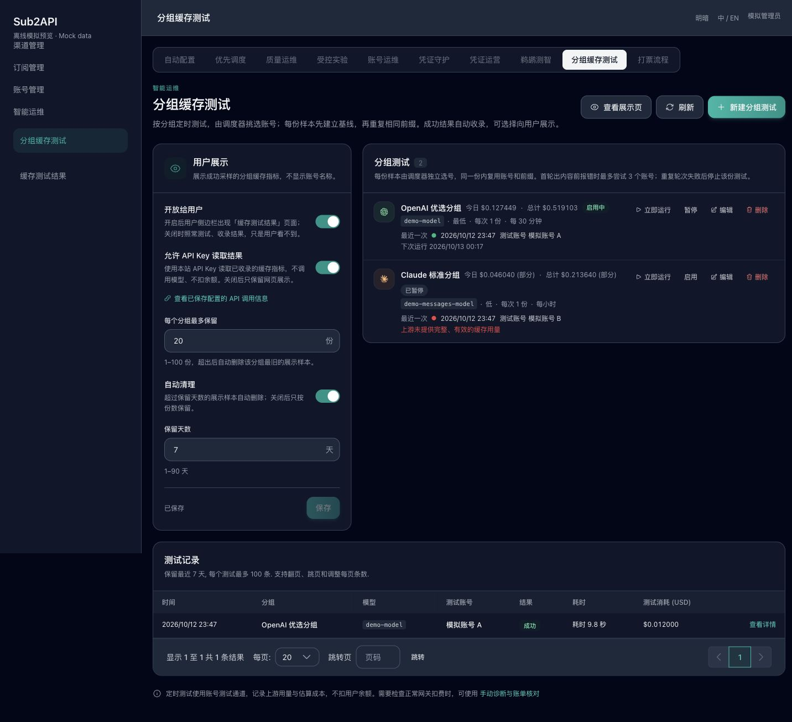
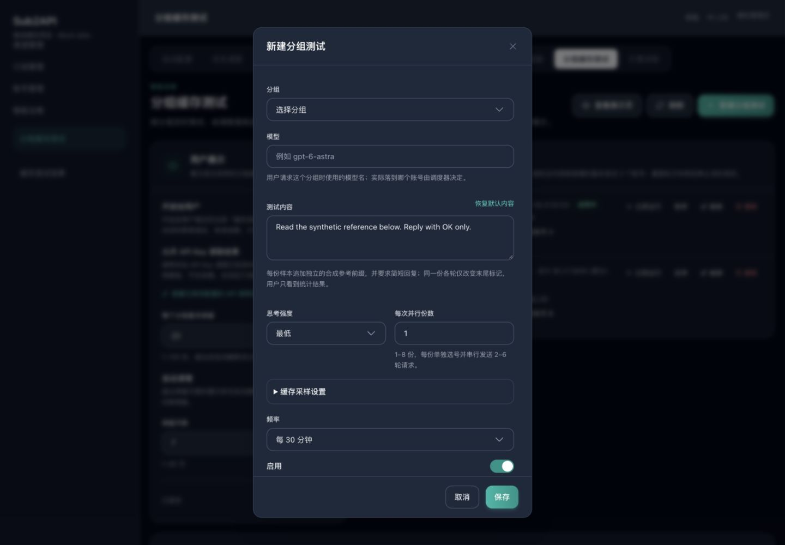
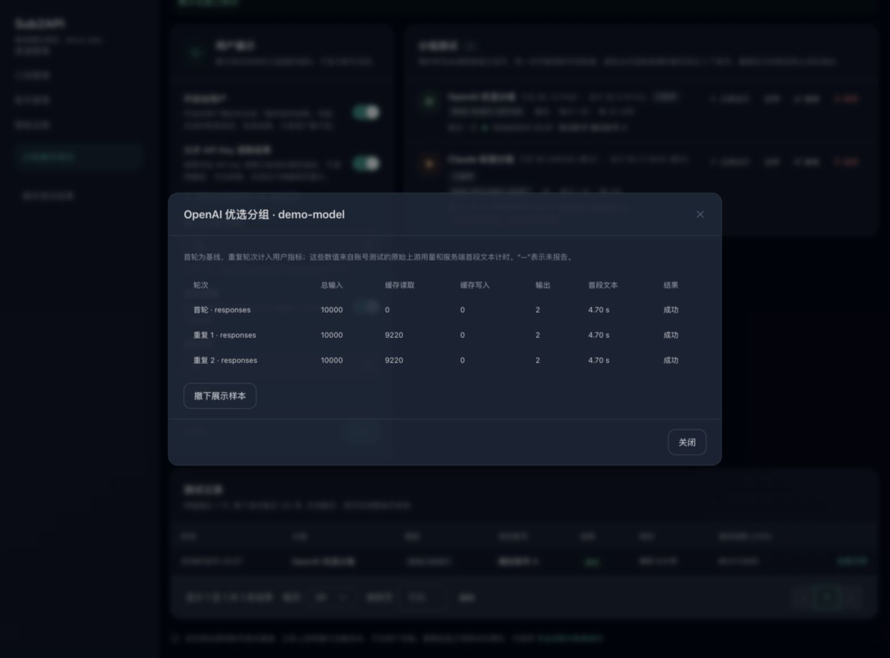
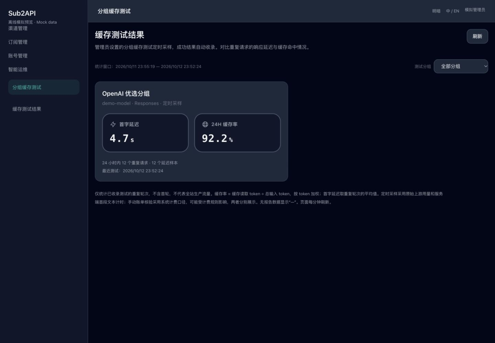
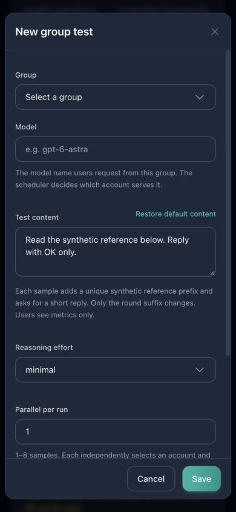
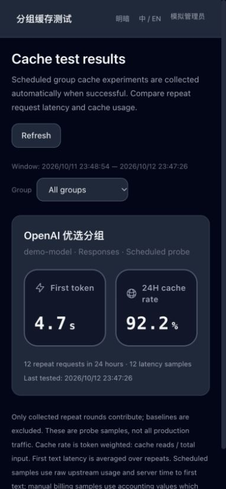

# 分组缓存测试

管理员入口：**智能运维 → 分组缓存测试**，路径 `/admin/group-cache-tests`。页面沿用「鹈鹕测智」的设置、分组计划和新建/编辑弹窗：由管理员指定分组、用户请求时使用的模型、测试内容、思考强度、并行份数和频率，调度器选号后进行多轮缓存采样。

成功样本自动收录。管理员可选择向已登录用户开放 `/group-cache-showcase`，也可另外允许有效 API Key 读取结果。展示与 API 开关默认关闭；关闭展示时仍测试、收录。用户主指标保持为**首字延迟 / 24H 缓存率**。

原浏览器计费诊断移到 `/admin/group-cache-probes`，仍使用操作者自己的分组 Key 走正常网关、核对实际账单；新定时页面底部保留该入口。

## 管理流程

1. 点击「新建分组测试」，选择有效的 OpenAI、Anthropic、复合或兼容平台分组，填写模型和测试内容；不需要个人 API Key。模型建议不代表可用性，实际映射和账号由已有分组调度器决定。
2. 选择思考强度、每次并行份数（1–8）和频率。频率预设与鹈鹕相同，也支持自定义 cron。新建表单默认启用，保存启用的计划后会按频率产生上游请求。
3. 「缓存采样设置」默认折叠：每份 3 轮、32 段合成前缀、最大输出 256 token、间隔 1 秒。允许 2–6 轮、8–128 段、16–8192 输出 token、0–30000ms 间隔。推理模型可能需要更大的输出预算；OAuth 通道的输出上限由上游约束。
4. 分组列表提供「立即运行」「启用/暂停」「编辑」「删除」，显示今日/累计估算成本、最近结果及测试账号、下次运行。暂停只阻止未来定时执行，仍可立即运行。编辑不能换分组。删除需要确认，并删除该计划的历史和展示样本；已发送的请求仍可能产生上游费用。
5. 「测试记录」可翻页、查看逐轮输入/缓存/输出 token、服务端首段文本时间、状态与耗时。撤下展示样本后测试历史保留。
6. 左侧「用户展示」统一保存开放给用户、API Key 读取、每组最多保留、自动清理和保留天数。刷新/后台轮询保留尚未保存的编辑。API 信息弹窗以**已保存**配置为准。

## 执行、调度与成本

每份样本使用独立随机标记和合成参考材料，同一份内共享前缀，只改变末尾轮次标记。首轮建立基线，后续轮次使用同一所选账号和槽位顺序执行。Claude 的 `cache_control: ephemeral` 标记放在共享文本块上，轮次后缀不加缓存标记。

使用鹈鹕相同的分组路由器，遵循现有账号可用性、模型映射、并发与复合分组路由。首轮在输出内容前失败时最多尝试 3 个账号；已有输出或重复轮次失败后不换账号、不重放该份测试。缺少有效缓存或输出用量、协议变化、流提前结束、拒绝、输出截断会使样本失败，失败样本不收录。

- 每实例最多同时运行 4 个缓存计划，每计划最多 8 份并行样本；每份内部串行发送请求。
- 手动与定时执行共享持久执行锁。同一计划跨实例不能同时启动；编辑后的旧调度快照不能抢锁，旧执行完成不能释放新执行的锁。
- 计划执行期限 10 分钟，单轮最多 2 分钟，执行锁 15 分钟。任务结束释放所选账号槽位；进程退出后锁超时才允许重跑。
- 接入现有 `ScheduledTestRunnerService` 每分钟 tick 和 runtime role 的启停规则。计划时间到点后在下一次扫描执行；配置的服务器时区决定 cron 和「今日」成本日期。
- 后台采样走账号测试通道，采集**原始上游用量**，以模型美元定价、服务档位与账号成本倍率估算成本；不扣用户余额、不写普通用户用量日志。它会消耗上游资源，估算数值不是供应商的结算账单。
- 费用包含已知的失败尝试。未返回用量/定价的调用显示未记录或部分，不能以零费用代替未知。累计按分组保存，不受历史清理或删除单个计划影响；只包括升级后记录的采样费用。

字符数不等于 token 数，不同上游的门槛、TTL、缓存实现和参数支持不同；合成前缀不能保证命中。不会改变分组缓存计费配置、账号状态或执行自动降级。

## 用户展示与指标

用户页面按**分组、模型、协议、数据来源**分别展示卡片，支持分组筛选、明暗模式、中英文和手机布局。页面每分钟、恢复可见或手动刷新时读取；开关/撤下在下一次读取生效，已加载的内容不会被即时推送删除。

| 来源 | 用量与延迟 |
| --- | --- |
| 定时采样 `upstream` | 账号测试上游原始用量 + 服务端请求开始至第一段非空文本的时间；不包含仅推理事件 |
| 手动账单核验 `billing` | 已核验系统账单的 token 分桶 + `first_token_ms`；可能受强制缓存计费、模型映射和倍率等规则影响 |

两种来源独立汇总，不混合成一个缓存率。

| 指标 | 口径 |
| --- | --- |
| 首字延迟 | 近 24 小时重复轮次的服务端延迟平均值；缺失的延迟不参与平均，显示延迟样本数 |
| 24H 缓存率 | 同一窗口内缓存读取 token 总和 / 总输入 token 总和，按 token 加权 |
| 样本数 | 窗口内参与统计的重复轮次和具有延迟的轮次数 |
| 最近测试 | 当前可见保留样本的最近测试时间 |

首轮不参与主指标。时间窗口按每轮测量时间计算，发布不会延长窗口；跨窗口的测试只计入窗口内轮次。OpenAI Responses / Chat 总输入已经包含缓存；Messages 总输入为普通输入 + 缓存读取 + 缓存写入。未报告的缓存写入、输出或延迟显示「—」，不推断为零；Anthropic 缺少写入分桶时不会发布不完整的总输入。实际测得零与未知分开显示。

没有近 24 小时样本但仍有可见的保留样本时，卡片保留最近时间，指标显示「—」。用户展示仅代表已收录的诊断样本，不代表全站生产流量，也不能证明上游物理缓存或供应商结算。

用户读取不按个人订阅或 Key 分组筛选已开放卡片，和鹈鹕展示保持一致。请使用适合对用户展示的分组名称。用户响应白名单不含操作者、账号、Key、计划/请求/账单 ID、费用、测试内容或响应正文。

## 保存、清理与 API

展示每组保留默认 20 份（1–100）；自动清理默认开启，保留默认 7 天（1–90）。关闭自动清理后仍执行数量上限。用户查询立即应用保存后的数量/年龄限制，不依赖后台清理；后台每分钟和执行完成后裁剪实际快照。手动发布与定时采样共享分组保留上限。

管理员采样历史独立保留最近 7 天、每计划最多 100 条。清理历史不会撤下展示快照；撤下不会删除测试记录。分组成本单独累计，删除计划不删除该分组成本；物理删除分组会级联删除成本。所有后台存储不包含账号凭据、原始请求/响应正文。管理员保存的测试内容和配置仅用于计划及管理员历史，用户结果不包含这些内容。

| API | 权限/行为 |
| --- | --- |
| `GET /api/v1/group-cache-showcase` | JWT 登录用户；关闭展示时返回空结果 |
| `GET/HEAD /api/v1/public/group-cache-showcase` | 有效、未过期本站 API Key；必须同时开启展示和 API，关闭时 403；免费读取，不调用模型、不扣余额、不更新 Key 使用记录 |
| `GET/PUT /api/v1/admin/group-cache-showcase/settings` | 管理员完整设置；兼容旧 `{enabled}` 请求，未提交字段保留 |
| `GET/POST /api/v1/admin/group-cache-tests` | 管理员计划列表/新建 |
| `PUT/DELETE /api/v1/admin/group-cache-tests/:id` | 管理员编辑/删除 |
| `POST /api/v1/admin/group-cache-tests/:id/run` | 管理员立即运行，任务在后台执行 |
| `GET /api/v1/admin/group-cache-test-results` | 管理员分页历史，支持 `plan_id` |
| `GET /api/v1/admin/group-cache-test-results/:id` | 管理员逐轮详情 |
| `GET/POST /api/v1/admin/group-cache-showcase/items`、`DELETE .../items/:id` | 原手动账单发布、分组列表和撤下，列表需 `group_id` |

API Key 只读鉴权保留用户/分组状态、访问范围和 IP 限制；余额或配额耗尽可读取已开放结果，过期或禁用 Key 拒绝。免费特例仅适用于上述 root 的 GET/HEAD，不匹配写方法和子路径。API 复用展示读取限流、无 Cookie 的只读 CORS；所有展示读取为 `Cache-Control: no-store`。配置读取失败或损坏时返回错误，不默认开放或默认清理。

公共设置 `group_cache_showcase_enabled` 只控制菜单入口，不包含结果。保存设置后刷新注入前端的菜单状态，后端每次读取仍独立验证设置。

## 手动计费诊断

`/admin/group-cache-probes` 保留 #405 的浏览器测试：选择当前用户的分组 Key，调用正常 `/v1/responses`、`/v1/chat/completions` 或 `/v1/messages`，记录网关原始用量、浏览器首段文本和系统实际扣费。它产生真实用户计费，与后台采样的账号成本估算不同。

账单通过返回的 `X-Client-Request-ID` 精确关联 `client:<ID>`，同时限制当前用户和 Key，不按时间/模型猜测。每轮账单匹配且测试完成后可显式发布；服务端重读账单核验操作者、分组、模型、协议与流式用量。仅接受 2–6 个不同轮次，最近 7 天内、有序、跨度最多 1 小时；同一账单不能进入多份快照。发布不自动开启展示。缺少关联头、账单待入库时保留未知状态，可只读核对，不重发模型请求。

本地诊断历史按登录用户隔离保留最多 20 次，可导出白名单 JSON。不保存 Key、JWT、原始请求/响应、上游错误正文或完整账单对象。停止、卸载取消浏览器请求，但服务端已处理部分仍可能计费；清空本地历史不撤下已发布结果。

## 迁移与回滚

- `277_group_cache_showcase.sql` 新增展示 runs/rounds；`278_group_cache_test_plans.sql` 新增计划、管理员结果、每日成本表，展示新增 `plan_id` 与 `source`，采样轮次无需普通 `usage_log_id`。旧快照默认来源 `billing`。不修改已应用的 277 文件或普通用户用量历史。
- 应用启动沿用既有迁移流程；Wire 接线已同步。展示和 API 默认关闭，升级不会把旧内容自动开放给用户。只有管理员创建启用计划才开始新后台采样。
- 回滚前暂停/删除缓存计划并关闭展示和 API，再回退二进制。回退不会删除新增表/设置；旧版本无法管理新定时计划。需要删除数据时另行评审前向清理迁移，不删改已应用迁移。未做生产或实际降级部署。

## 验证与截图

前端关键集合涵盖新建/编辑/暂停/运行、固定分组、完整设置、未保存编辑、逐轮详情和撤下；另有手动诊断、账单匹配、发布、用户筛选、未知/零、刷新/卸载及中英文文案测试。后端定向测试涵盖计划参数、执行锁、原始用量、费用、首段文本、截断/拒绝/EOF、设置 fail closed、权限与 DTO 白名单；对受影响服务做 race 检查。

隔离 PostgreSQL/Redis 集成测试实际应用至迁移 278，验证执行锁、过期完成、历史分页、成本累计、清理和删除级联，以及读时保留限制、时间窗口和来源分开统计。

下图使用**虚构分组/账号与模拟 API**，主体为实际组件，外层是简化离线布局；用于操作及中英文、明暗、桌面/390px 手机检查，不代表完整应用联调或真实缓存表现。没有连接生产数据或发真实付费请求。

原手动诊断截图仍可参考：

