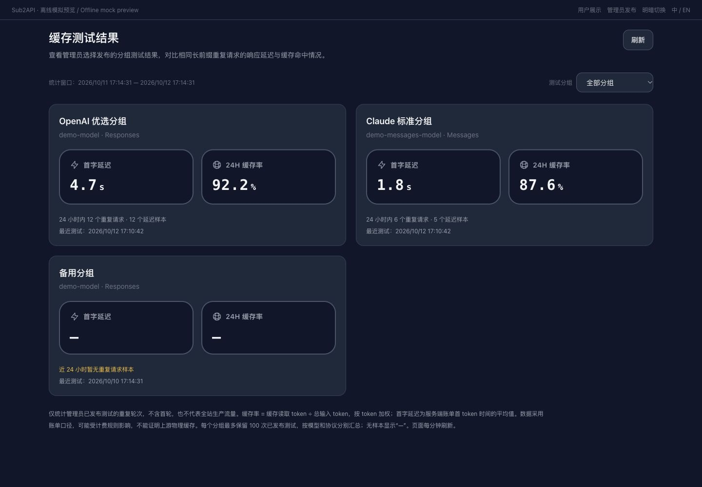
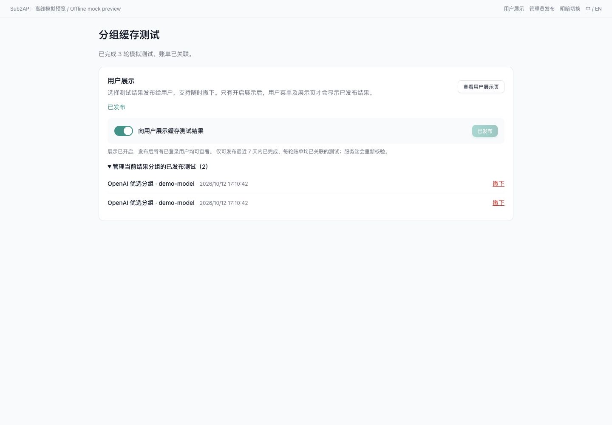
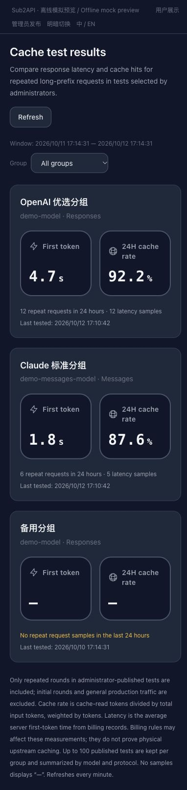

# 分组缓存测试

管理员入口：**智能运维 → 分组缓存测试**，路径为 /admin/group-cache-tests。

管理员可选择把完成的测试发布到用户菜单 **缓存测试结果**，路径为 /group-cache-showcase。展示开关默认关闭，只有管理员主动开启后，已登录用户才能查看已发布结果；与鹈鹕测智展示一样，不提供匿名访问。

这个页面通过当前登录用户已有的分组 API Key，调用正常网关，观察该分组在连续请求中的缓存表现。测试会产生真实计费；默认 3 轮、48 段合成前缀、1 秒间隔、单轮 120 秒超时、最大输出 256 token。一次最多 6 轮，失败即停止，页面不会自动重试模型请求。网关自身既有的调度及故障转移规则仍然生效。

## 使用

1. 选择一个有效分组，再选择**当前登录用户**绑定此分组的有效 Key。没有 Key 时，先到“我的 Key”页面自行配置。页面不创建 Key、不代用其他用户的 Key，也不修改分组。
2. 输入分组支持的模型 ID，选择对应接口。模型建议列表仅供参考，不保证当前 Key 有权使用所有候选模型。
3. 根据需要调整前缀长度、轮数、间隔、超时、输出上限，以及 Responses / Chat 的服务档位和推理强度。参数必须由模型支持；推理模型可能需要增加输出预算。
4. 点击“开始计费测试”。每次测试使用一个新的随机标记，同次测试各轮保持前缀不变，只改变末尾的轮次标记。
5. 在结果表点击“首轮”或“重复”展开响应模型、服务档位、耗时、关联 ID，以及系统账单的实际路由、token、费用分项与倍率。
6. 可停止测试，或等待完成后导出 JSON。关闭页面也会取消正在进行的请求。已被服务端处理的部分仍可能计费。
7. 系统日志可能晚于响应入库。自动核对有次数及时间上限；未匹配时显示“待核对”，稍后点击“核对账单”只会查询日志。

## 协议与指标

| 协议 | 端点 | 缓存请求方式 | 响应用量 |
| --- | --- | --- | --- |
| Responses | /v1/responses | 相同早期输入前缀 | input_tokens 及 input_tokens_details |
| Chat Completions | /v1/chat/completions | 相同早期消息前缀；stream_options.include_usage | prompt_tokens 及 prompt_tokens_details |
| Messages | /v1/messages | 在固定文本块末尾添加 cache_control: ephemeral | input_tokens、cache_read_input_tokens、cache_creation_input_tokens |

接口只发送合成参考材料，不接受私人长文本，也不保存模型回答。不同模型/上游的缓存门槛、TTL、缓存写入报告与参数支持不同；字符数不等于 token 数，不保证某个长度一定命中。没有报告的缓存字段显示“—”，不会推断为零。若响应提供 cache_write_tokens 则记录它，否则 OpenAI 兼容接口的写入量保持未知。

- **命中率** = 缓存读取 token / 总输入 token；读取与写入分开。Responses / Chat 的输入已含缓存，Messages 的输入需合并三个桶。
- **重复轮次命中率**按完整且具有有效缓存数据的轮次累加 token 后计算，不平均百分比。摘要明确显示参与计算的轮数。
- **首段文本**是浏览器发起请求至第一段非空文本的时间，不包含仅推理事件。服务端首 token 和浏览器总耗时在详情中分别展示。
- **实际扣费**来自系统 usage log 的 actual_cost。账单 input_tokens、cache_read_tokens、cache_creation_tokens 是分开的桶，展示总输入时才相加。
- 响应 token 和账单 token 各自保留，不互相覆盖。强制缓存计费、模型映射、账号切换、定价和倍率等配置可能造成差异。
- 页面显示的是网关报告和本系统账单，不能证明上游物理缓存命中，也不代表上游供应商的实际结算。首轮同样可能命中缓存。

## 请求与账单的关联

网关返回 X-Client-Request-ID，页面以 `client:<ID>` 查询 /api/v1/admin/usage，且同时限制当前用户和本次 Key。不会按时间、模型或 token 数猜测匹配，不依赖浏览器自行发送的关联 ID。跨域部署需保留 CORS 暴露的 X-Client-Request-ID；缺少该响应头时明确显示“无关联 ID”。

即使超时、取消或 SSE 错误，也保留已观察到的请求 ID 和用量，以便后续只读核对。HTTP 200 不等于成功：必须收到协议的正常终止事件。无效 SSE、提前 EOF、上游错误和输出截断都使本轮失败，并停止后续轮次。

## 可选的用户展示

1. 完成测试并确认每轮账单均已关联，在页面顶部“用户展示”区域点击“发布当前结果”。也可选择本地历史中的已完成结果后发布。
2. 发布只保存该次测试的服务端快照，不会自动开启展示。打开“向用户展示缓存测试结果”后，所有已登录用户可从菜单查看结果；这里不按用户的 Key 或订阅分组限制可见性，发布前请确认分组名称适合展示。
3. “管理当前结果分组的已发布测试”可查看和撤下该分组的快照。撤下一个结果后，下一次用户查询不再计入其样本；关闭总开关则隐藏所有结果，保留已发布快照供以后开启。
4. 用户页面按分组、模型、协议分别展示卡片，可筛选分组。可见页面每分钟刷新，切回页面或手动刷新也会重新读取；关闭展示或撤下不会瞬间清除用户已加载的页面。

发布只接受最近 7 天内、同一次测试的 2–6 轮，轮次时间须有序且总跨度不超过 1 小时。服务端根据账单 ID 与请求 ID 重新核验当前操作者、Key、实际分组、请求模型、入站端点及流式用量，再保存统计字段。浏览器提交的百分比、耗时和时间不作为发布数据；同一账单不能同时进入多个已发布测试。测试失败、停止或账单待核对时，页面不允许发布。

### 卡片指标

| 指标 | 口径 |
| --- | --- |
| 首字延迟 | 近 24 小时内已发布重复轮次的服务端账单 `first_token_ms` 平均值，显示为秒；缺失的延迟不参与平均 |
| 24H 缓存率 | 同一窗口内重复轮次的缓存读取 token 总和 / 总输入 token 总和，按 token 加权；账单总输入为普通输入 + 缓存读取 + 缓存写入 |
| 样本数 | 该窗口内参与统计的重复轮次，以及其中具有延迟数据的轮次数 |
| 最近测试 | 当前保留的已发布测试中，最后一轮的账单记录时间 |

时间窗口按每轮账单记录时间计算，不按发布时间延长。首轮不参与两个主指标；如果一组测试跨过窗口边界，只计入窗口内的重复轮次。没有近 24 小时样本时保留卡片和最近测试时间，指标显示“—”；有测量且为零时显示 `0.0`。

这些指标只代表**管理员选择发布的探测样本**，不是全站生产流量。用户展示采用系统账单口径，可能受强制缓存计费等规则影响，不证明上游物理缓存，也不能据此推断供应商结算。它与管理员测试表中来自网关响应的命中率、浏览器首段文本计时是不同的数据来源。

### API 与权限

- 用户只读：`GET /api/v1/group-cache-showcase`，需要 JWT 登录，使用现有面板重查询限流。响应不包含操作者、Key、账号、账单 ID、请求 ID、费用或请求/响应正文。
- 管理员设置：`GET/PUT /api/v1/admin/group-cache-showcase/settings`。
- 管理员发布管理：`GET/POST /api/v1/admin/group-cache-showcase/items`、`DELETE /api/v1/admin/group-cache-showcase/items/:id`。列表需要 `group_id`。
- 后端每次读取都检查展示开关，并返回 `Cache-Control: no-store`。关闭时返回空结果；设置读取失败时返回错误。用户不能通过写接口发布或修改。
- 公共设置中的 `group_cache_showcase_enabled` 只控制菜单入口，不暴露结果；未配置时为 false。开关变更会刷新注入前端的公共设置。

## 保存范围、迁移与限制

- 完整测试历史存在当前浏览器，按登录用户隔离，最多 20 次；刷新后可查看与导出，未完成记录显示为已停止。清空本地历史不会撤下已经发布的结果。
- 本地持久化和导出逐字段白名单处理，不包含 Key 密钥、面板 JWT、原始请求/响应、上游错误正文、完整用户或账单对象。
- 已发布快照单独保存在服务端，每个分组按测试时间保留最近 100 次，超出后在发布事务中删除最早的快照及其轮次。普通用量日志清理不会删除快照；撤下、保留上限清理或物理删除关联用户/分组会删除相应快照。
- 迁移 `277_group_cache_showcase.sql` 新增 `group_cache_showcase_runs` 与 `group_cache_showcase_rounds` 两张表，不修改历史用量日志。应用启动按现有迁移流程建表，Wire 已同步生成。只有显式发布的结果才入表，既有历史不会自动对外展示。
- 回滚时先关闭展示，再回退应用版本。仅回退二进制不会移除新表或设置；旧版本不使用这些新增表。需彻底删除数据时应另行评审前向清理迁移，不修改或删除已应用的迁移文件。未在实际部署中验证二进制降级。
- 本功能没有定时测试、后台测试执行、跨分组并发比较、自动配置/降级或 Key 创建。离开页面后不会继续运行。
- 额外 CORS 响应头不改变现有网关鉴权和计费规则；展示/发布接口只读账单或保存快照，不会发送模型请求。

## 验证与截图

新增单元测试覆盖三种协议、固定前缀、token 归一化、加权统计、缺失用量、SSE 分片、HTTP 错误、EOF、超时、取消、精确账单匹配、延迟/失败查询、历史白名单及损坏数据。页面测试覆盖 Key 所有权与分组校验、切换竞态、停止、卸载及历史核对。测试已加入 Makefile 的前端关键用例集合。

展示功能另有前端发布/撤下/切换、分组筛选、未知与零值、定时刷新及卸载测试；后端测试覆盖默认关闭、重新核验账单、只读结果脱敏、输入边界及路由鉴权。隔离 PostgreSQL/Redis 集成测试实际执行迁移，覆盖窗口边界、按 token 加权、缺失延迟、重复发布回滚、分组停用、撤下级联及 100 次保留上限。

下图使用虚构分组、虚构 Key 和本地模拟 SSE/账单/展示 API，仅验证 UI 交互。页面主体使用实际组件，外层使用简化的离线预览布局。浏览器验证覆盖发布、撤下、关闭展示、筛选及中英文桌面/窄屏布局；这些截图不是完整前后端联调证据。没有连接生产数据库或发送真实付费模型请求。真实缓存收益仍需在目标部署中由操作者测试。

